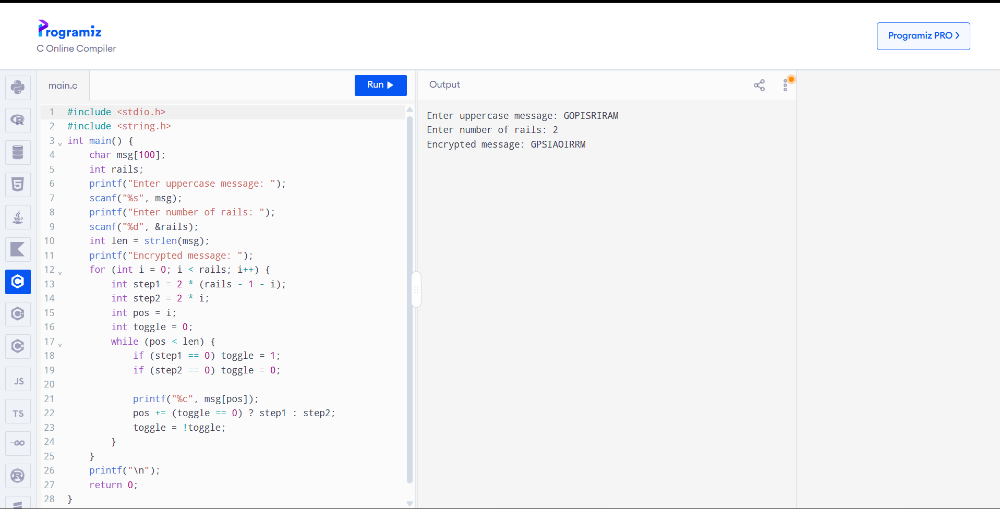
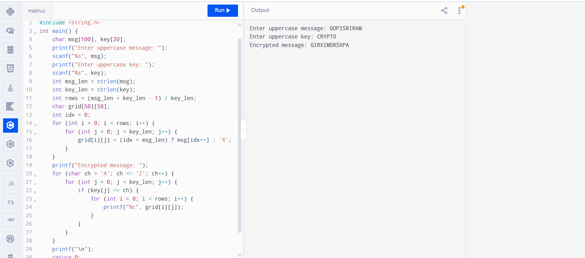

# Ex-4 Rail-Fence-Program

# IMPLEMENTATION OF RAIL FENCE – ROW & COLUMN TRANSFORMATION TECHNIQUE

# AIM:

# To write a C program to implement the rail fence transposition technique.

# DESCRIPTION:

In the rail fence cipher, the plain text is written downwards and diagonally on successive "rails" of an imaginary fence, then moving up when we reach the bottom rail. When we reach the top rail, the message is written downwards again until the whole plaintext is written out. The message is then read off in rows.

# ALGORITHM:

STEP-1: Read the Plain text.
STEP-2: Arrange the plain text in row columnar matrix format.
STEP-3: Now read the keyword depending on the number of columns of the plain text.
STEP-4: Arrange the characters of the keyword in sorted order and the corresponding columns of the plain text.
STEP-5: Read the characters row wise or column wise in the former order to get the cipher text.

# PROGRAM

Row Transformation (Rail Fence Cipher)

```
#include <stdio.h>
#include <string.h>

int main() {
    char msg[100];
    int rails;

    printf("Enter uppercase message: ");
    scanf("%s", msg);
    printf("Enter number of rails: ");
    scanf("%d", &rails);

    int len = strlen(msg);
    printf("Encrypted message: ");
    
    for (int i = 0; i < rails; i++) {
        int step1 = 2 * (rails - 1 - i);
        int step2 = 2 * i;
        int pos = i;
        int toggle = 0;

        while (pos < len) {
            if (step1 == 0) toggle = 1;
            if (step2 == 0) toggle = 0;

            printf("%c", msg[pos]);
            pos += (toggle == 0) ? step1 : step2;
            toggle = !toggle;
        }
    }
    printf("\n");
    return 0;
}
```

Columnar Transposition Technique

```
#include <stdio.h>
#include <string.h>

int main() {
    char msg[100], key[20];
    
    printf("Enter uppercase message: ");
    scanf("%s", msg);
    printf("Enter uppercase key: ");
    scanf("%s", key);

    int msg_len = strlen(msg);
    int key_len = strlen(key);
    int rows = (msg_len + key_len - 1) / key_len;
    
    char grid[50][50];
    int idx = 0;

    for (int i = 0; i < rows; i++) {
        for (int j = 0; j < key_len; j++) {
            grid[i][j] = (idx < msg_len) ? msg[idx++] : 'X';
        }
    }

    printf("Encrypted message: ");
    for (char ch = 'A'; ch <= 'Z'; ch++) {
        for (int j = 0; j < key_len; j++) {
            if (key[j] == ch) {
                for (int i = 0; i < rows; i++) {
                    printf("%c", grid[i][j]);
                }
            }
        }
    }
    printf("\n");
    return 0;
}
```

# OUTPUT

Row Transformation (Rail Fence Cipher)


Columnar Transposition Technique


# RESULT
